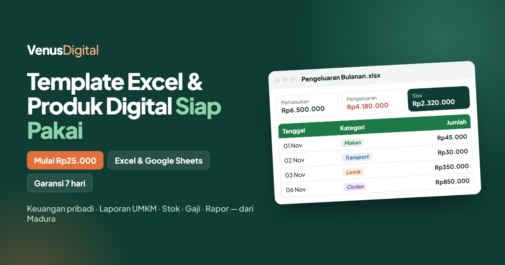

<h1 align="center">Venus Digital</h1>

<p align="center">
  Toko online template Excel &amp; produk digital siap pakai dari Pamekasan, Madura.<br>
  <a href="https://haidarhafiz21.github.io/venusdigital/"><b>Lihat website ↗</b></a>
</p>

<p align="center">
  <a href="https://haidarhafiz21.github.io/venusdigital/"></a>
</p>

## Fitur

- **Katalog 12 produk** dengan filter kategori, pencarian cepat (<kbd>Ctrl</kbd> + <kbd>K</kbd>), dan pratinjau produk.
- **Halaman produk lengkap**, masing-masing dengan gambar pratinjau sendiri untuk dibagikan ke media sosial.
- **Artikel panduan** keuangan dan UMKM yang menautkan ke produk terkait.
- **Pemesanan & request custom via WhatsApp**: pesan otomatis terisi sesuai produk yang dipilih.
- **SEO**: sitemap, data terstruktur (Store, Product, Article, FAQ), Open Graph, dan IndexNow.
- **Animasi halus** dengan mode ringan otomatis di HP supaya scroll tetap mulus.
- **Tanpa framework dan tanpa library**: HTML, CSS, dan JavaScript murni, sehingga ringan dan cepat dimuat.

## Teknologi

HTML · CSS · JavaScript · Node.js (pembuat halaman statis) · GitHub Pages

## Struktur

```
index.html            Beranda (katalog, cara beli, FAQ, request custom)
produk/<slug>/        Halaman tiap produk        ┐
artikel/              Artikel panduan            ├─ dibuat oleh tools/build.js
kebijakan-*/          Halaman kebijakan          ┘
assets/js/products.js Data produk (satu sumber untuk semua halaman)
assets/js/main.js     Logika beranda
assets/js/page.js     Logika halaman produk & artikel
assets/css/style.css  Seluruh tampilan
tools/build.js        Pembuat halaman statis + sitemap.xml
tools/content.js      Isi artikel & halaman kebijakan
```

## Menjalankan

Buka `index.html` langsung di browser, atau jalankan server lokal apa saja. Setelah mengubah data produk atau isi artikel, buat ulang halaman turunan dan sitemap dengan:

```bash
node tools/build.js
```

---

<p align="center">Dibuat oleh <a href="https://github.com/haidarhafiz21">A. Haidar Hafiz</a></p>

<p align="center"><sub>Hak cipta © 2026 A. Haidar Hafiz. Seluruh hak dilindungi — lihat <a href="LICENSE">LICENSE</a>.</sub></p>
